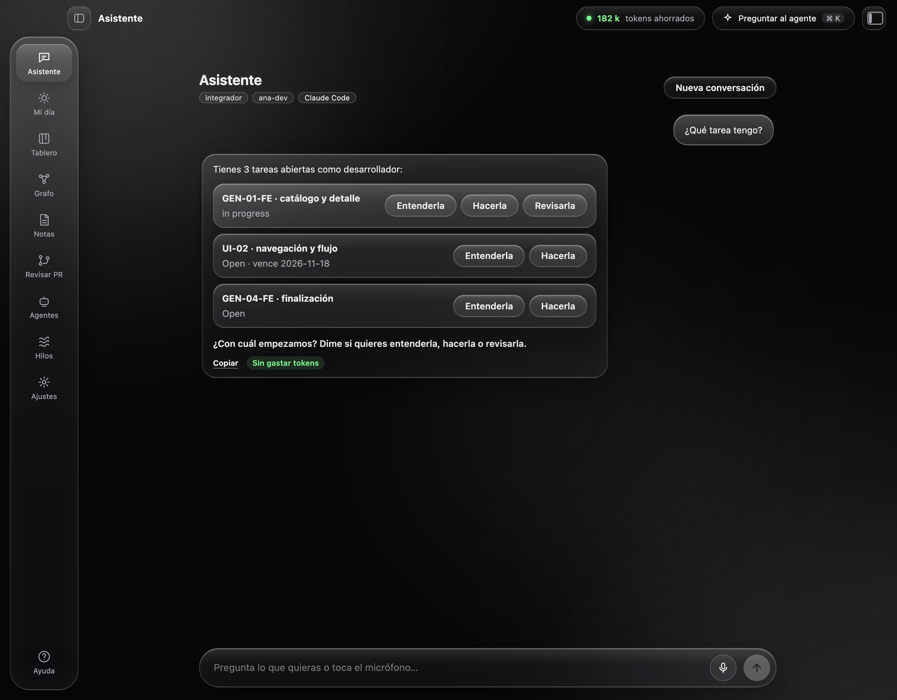
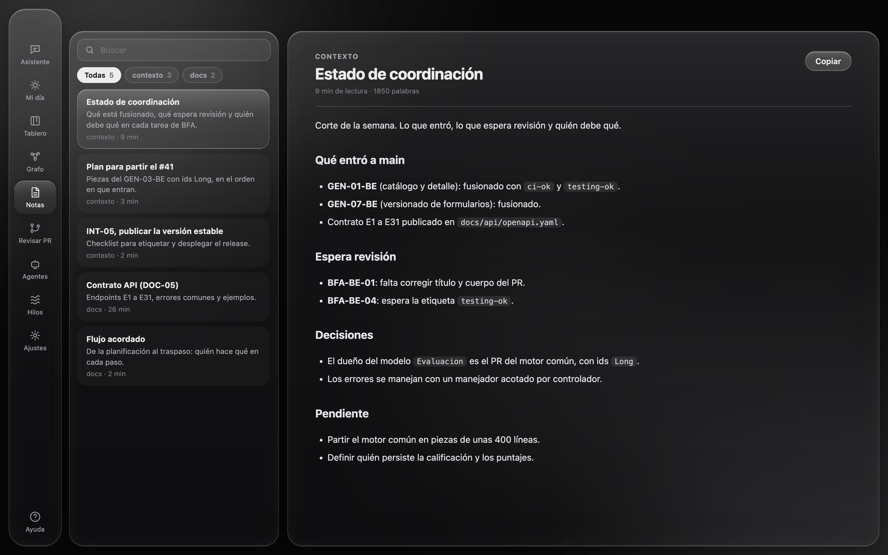

# hilo

app de escritorio para que un equipo entregue completo a la primera. junta el grafo del proyecto, las notas en markdown, los formatos acordados y un agente de claude code o codex, todo con tu suscripción y sin claves de api.




## qué resuelve

| problema | en hilo |
|---|---|
| el integrador revisa el mismo pr varias veces | `hilo revisar <pr>` entrega una sola lista con todo lo que el formato exige |
| comentarios de clickup incompletos | plantillas de avance, entrega, bloqueo y pregunta, y un validador de lo que llega |
| la ia gasta tokens releyendo todo (opcional y configurable en ajustes: tres preajustes y cada técnica por separado) | resumen del proyecto (~400 tokens en vez de ~32 mil), vecindad de un nodo, sesión nueva con el hilo, notas recortadas a los párrafos útiles, logs comprimidos, estilo breve en subagentes y medidor de ahorro |
| la ia pierde el hilo o inventa | el hilo de la tarea se reinyecta en cada turno, y un motor de reglas decide cuándo seguir, preguntar o parar |
| revisar PR a mano uno por uno | los PR listos se revisan solos; un clic copia o publica la lista de correcciones, y una tarea programada avisa de los nuevos con errores |
| nadie sabe quién frena a quién | «quién te frena» cruza dependencias de clickup, revisiones, checks y rama atrasada, nombra a la persona y deja el recordatorio escrito |
| las tareas pendientes se acumulan | el piloto automático convierte tu día en pasos: lo que hilo resuelve solo (rama al día, entrega y bloqueo redactados con el sha real, avisos), lo que redacta un agente ligero y lo que un agente hace en un espacio aislado (arreglar el ci, aplicar una revisión, la primera pieza de una tarea), con las comprobaciones corridas sin modelo |
| un solo integrador lo carga todo | reparto por carga entre integradores y métrica de rondas por pr |

### piloto automático

un botón, «hacer mis pendientes». hilo ordena los pasos del más barato al más caro, los corre y deja el resultado en una bandeja. **nada llega a otras personas sin tu aprobación**: comentarios, ramas y pr se confirman en un cuadro con el resumen.

- los agentes que editan código corren en una copia aislada (git worktree) y en su propia rama, con herramientas acotadas: leer, editar, probar y guardar commits locales. sin push, sin borrar, sin red.
- después de editar, hilo corre las comprobaciones del perfil sin pasar por el modelo; solo lo que falla vuelve, comprimido, y se reintenta una vez.
- la preparación diaria (tarea programada) deja listo, sin gastar tokens, lo que hilo resuelve solo.

### el grafo, útil de verdad

elige un nodo y hilo te dice, sin gastar tokens, qué usa, qué lo usa y qué podría romperse si lo cambias (hasta 3 saltos), busca el camino entre dos nodos y te sugiere por dónde empezar a leer. desde ahí le preguntas al agente con solo ese contexto: la pantalla muestra cuántos tokens manda frente al proyecto entero. fija varios nodos para armar un paquete a la medida y copiarlo a tu propia terminal.

### el agente en toda la app

`⌘K` (o `ctrl+k`) abre la paleta desde cualquier pantalla: pregunta, salta a una sección o busca un nodo. cada pantalla tiene su botón para preguntar con el contexto justo. la navegación se puede mover (izquierda, derecha, arriba, abajo), reducir a iconos u ocultar con `⌘B`, y se recuerda.

### ahorro de tokens, medido

ajustes › ahorro muestra dos cifras por separado: lo **gastado**, que cuenta la propia cli de claude code o codex al terminar cada paso, y lo **evitado**, que compara el texto crudo con el que hilo mandó (caracteres entre 4: es una estimación, no una factura). las técnicas: registros de ci reducidos al fallo, comentarios de revisión compactos con archivo y línea, diffs comprimidos, modelo ligero para redactar y el de desarrollo solo para editar, respuesta reutilizada si el paso es idéntico sobre el mismo commit, tope de gasto por paso y pasos que no usan modelo.





## instalar

descarga el instalador de tu sistema en [releases](https://github.com/kisnner26/hilo/releases/latest): macos (apple silicon), windows y linux.

## conectar y empezar

abre la app y conecta tus cuentas, una sola vez:

1. **github:** el botón abre el navegador y te da un código. hilo no ve tu contraseña (usa `gh`).
2. **clickup:** pega tu token de api (tu foto, configuración, apps). se guarda cifrado con el llavero del sistema.
3. **repositorio:** agrega cualquiera con `dueño/nombre` o su dirección.

con eso hilo sabe quién eres y la pantalla **mi día** muestra tus tareas, tus pr y qué hacer ahora, con el comentario de entrega ya preparado. los avisos automáticos (ci roto, cambios pedidos, tarea vencida) se activan en ajustes.

## usar

requisitos: node 22 o superior, `gh` con sesión y claude code con sesión (`claude auth login`).

```bash
npm install
npm run build
npm run dev -w @hilo/desktop        # app de escritorio
node packages/cli/dist/main.js ayuda
node packages/cli/dist/main.js instalar-skill   # skill /hilo para claude code
```

en ajustes eliges el `graph.json` de graphify y la carpeta de markdown. la app se puede probar sin electron: `npx vite --config apps/desktop/vite.web.config.ts` abre la interfaz con datos de demostración.

## si una conexión falla

en ajustes, conexiones, **probar todas las conexiones** revisa herramientas (git, gh, claude, codex), llavero, github, clickup y suscripciones, y dice qué hacer en cada falla. github funciona con `gh` o con un token personal pegado.

## suscripción, sin api

hilo no guarda claves ni tokens. lanza `claude` y `codex` como procesos y cada persona entra con su cuenta (`claude auth login --claudeai`, `codex login`). el modelo y el esfuerzo se eligen por función en ajustes: orquestador, desarrollo, documentación, integración y testing.

codex está implementado pero no se probó en esta máquina porque no estaba instalado.

## otro proyecto

todo lo propio del proyecto vive en un perfil json (`profiles/`): patrón de rama, título y cuerpo del pr, límites, archivos prohibidos, roles y modelos. para otro equipo se copia el perfil y se cambian esos valores; el núcleo (`packages/core`) no cambia.

## estructura

- `packages/core`: reglas, plantillas, contexto, hilo, decisión, reparto y plan xp. sin dependencias.
- `packages/cli`: comando `hilo`.
- `apps/desktop`: electron, react y three.
- `skill/hilo`: skill para claude code.

licencia mit.
