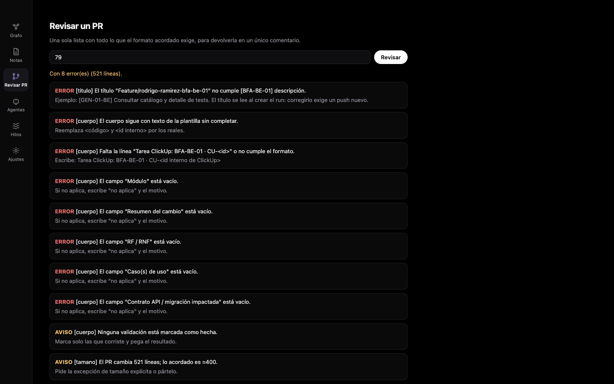

# hilo

app de escritorio para que un equipo entregue completo a la primera. junta el grafo del proyecto, las notas en markdown, los formatos acordados y un agente de claude code o codex, todo con tu suscripción y sin claves de api.


## qué resuelve

| problema | en hilo |
|---|---|
| el integrador revisa el mismo pr varias veces | `hilo revisar <pr>` entrega una sola lista con todo lo que el formato exige |
| comentarios de clickup incompletos | plantillas de avance, entrega, bloqueo y pregunta, y un validador de lo que llega |
| la ia gasta tokens releyendo todo | paquetes de contexto por rol y por vecindad, con presupuesto de tokens |
| la ia pierde el hilo o inventa | el hilo de la tarea se reinyecta en cada turno, y un motor de reglas decide cuándo seguir, preguntar o parar |
| un solo integrador lo carga todo | reparto por carga entre integradores y métrica de rondas por pr |



## conectar y empezar

abre la app y conecta tus cuentas, una sola vez:

1. **github:** el botón abre el navegador y te da un código. hilo no ve tu contraseña (usa `gh`).
2. **clickup:** pega tu token de api (tu foto, configuración, apps). se guarda cifrado con el llavero del sistema.
3. **repositorio:** agrega cualquiera con `dueño/nombre` o su dirección.

con eso hilo sabe quién eres y la pantalla **mi día** muestra tus tareas, tus pr y qué hacer ahora, con el comentario de entrega ya preparado. los avisos automáticos (ci roto, cambios pedidos, tarea vencida) se activan en ajustes.

## usar

requisitos: node 22 o superior, `gh` con sesión y claude code con sesión (`claude auth login`).

```bash
npm install
npm run build
npm run dev -w @hilo/desktop        # app de escritorio
node packages/cli/dist/main.js ayuda
node packages/cli/dist/main.js instalar-skill   # skill /hilo para claude code
```

en ajustes eliges el `graph.json` de graphify y la carpeta de markdown. la app se puede probar sin electron: `npx vite --config apps/desktop/vite.web.config.ts` abre la interfaz con datos de demostración.

## suscripción, sin api

hilo no guarda claves ni tokens. lanza `claude` y `codex` como procesos y cada persona entra con su cuenta (`claude auth login --claudeai`, `codex login`). el modelo y el esfuerzo se eligen por función en ajustes: orquestador, desarrollo, documentación, integración y testing.

codex está implementado pero no se probó en esta máquina porque no estaba instalado.

## otro proyecto

todo lo propio del proyecto vive en un perfil json (`profiles/`): patrón de rama, título y cuerpo del pr, límites, archivos prohibidos, roles y modelos. para otro equipo se copia el perfil y se cambian esos valores; el núcleo (`packages/core`) no cambia.

## estructura

- `packages/core`: reglas, plantillas, contexto, hilo, decisión, reparto y plan xp. sin dependencias.
- `packages/cli`: comando `hilo`.
- `apps/desktop`: electron, react y three.
- `skill/hilo`: skill para claude code.

licencia mit.
