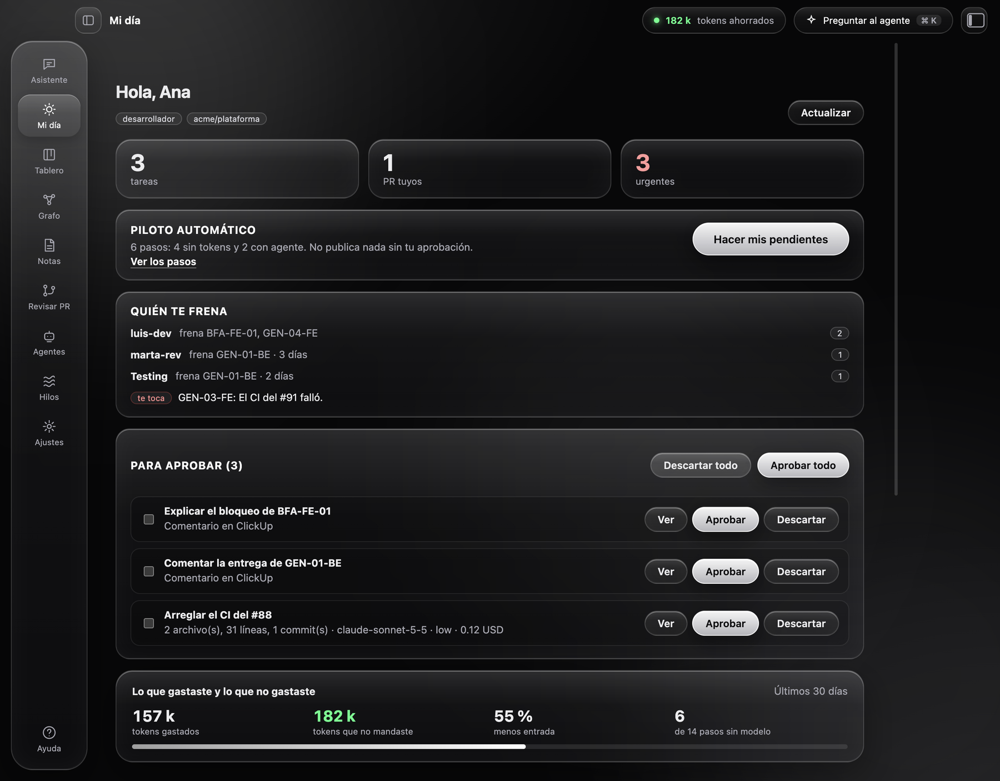
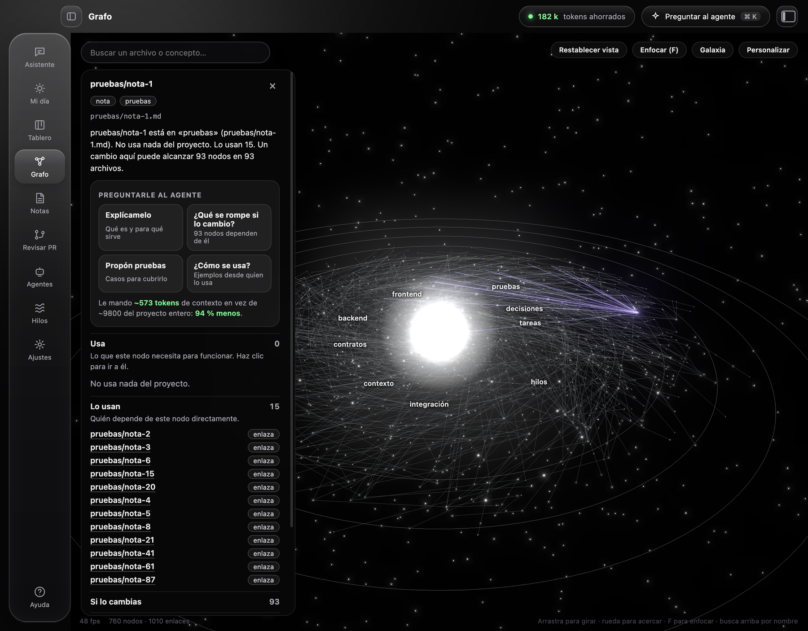
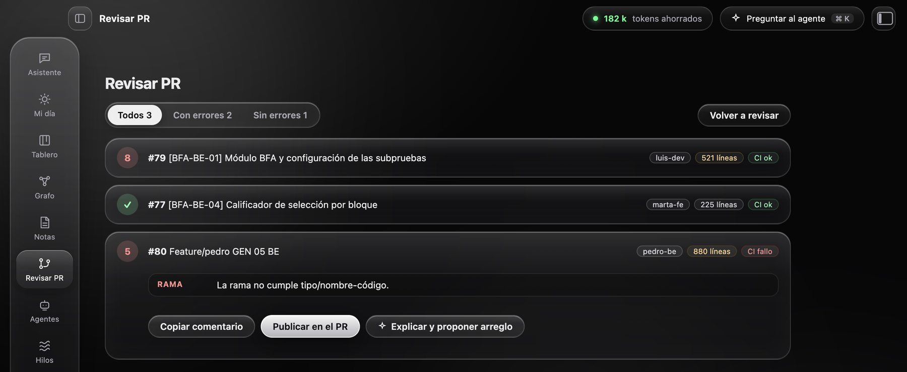
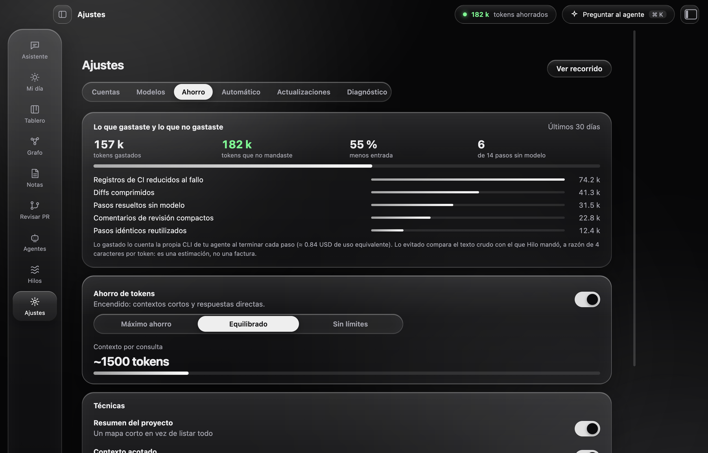
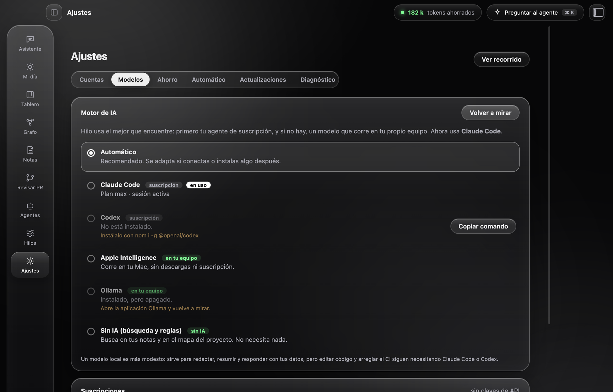

# hilo

app de escritorio que junta tu clickup y tu github y te dice qué te toca hoy, quién te frena y qué le falta a tu pr. con un agente (claude code, codex o una ia que corre en tu equipo) que gasta menos tokens que tu terminal. sin claves de api.

**[descargar para mac, windows o linux](https://github.com/kisnner26/hilo/releases/latest)**



## qué hace

- **qué te toca hoy:** tus tareas de clickup y tus pr de github por urgencia, con el comentario de entrega ya preparado.
- **quién te frena:** nombra a la persona o al pr que detiene tu tarea y deja el recordatorio escrito.
- **piloto automático:** «hacer mis pendientes» prepara tu día. lo que no necesita modelo sale gratis y nada llega a otras personas sin tu aprobación.
- **revisión de pr:** una sola lista de correcciones según el formato acordado, antes de pedir revisión. los integradores ven toda la cola, con las migraciones.
- **asistente con voz:** pregunta escribiendo o hablando, en español o inglés. `⌘K` lo abre desde cualquier pantalla.
- **grafo útil:** qué usa un archivo, qué lo usa y qué se rompe si lo cambias. el agente recibe solo ese contexto.
- **ahorro de tokens medido:** lo gastado de verdad frente a lo que se evitó mandar.

<p align="center">
  
  
</p>
<p align="center">
  
  
</p>

## instalar

| sistema | archivo |
|---|---|
| macos (apple silicon) | `.dmg` |
| windows | `.exe` |
| linux | `.AppImage` |

están en [releases](https://github.com/kisnner26/hilo/releases/latest). la app no está firmada: en mac, clic derecho y abrir la primera vez; en windows, «más información» y «ejecutar de todos modos». después se actualiza desde la propia app, en ajustes › actualizaciones.

## empezar

conecta tus cuentas, una sola vez:

1. **github:** el botón abre el navegador y te da un código (usa `gh`), o pega un token personal.
2. **clickup:** pega tu token de api; se guarda cifrado con el llavero del sistema.
3. **repositorio:** agrega el tuyo como `dueño/nombre`.

si algo falla, ajustes › diagnóstico revisa herramientas, llavero, github, clickup y suscripciones, y dice qué hacer.

## qué ia usa

hilo detecta solo la mejor y la cambias en ajustes › modelos:

1. **claude code o codex**, con tu suscripción. los únicos que editan código y arreglan el ci.
2. **apple intelligence** (mac con chip m): corre en tu mac, sin descargar nada.
3. **ollama** (cualquier sistema): corre en tu equipo con el modelo que tengas.
4. **sin ia:** busca en tus notas y en el grafo, y sigue mostrando mi día, quién te frena y la revisión de formato, que no usan modelo.



un modelo local es más modesto: redacta, resume y responde con tus datos. editar código sigue pidiendo claude code o codex (codex está implementado, aún sin probar a fondo). para dictar con la mejor precisión en mac: `brew install whisper-cpp` y descargar el modelo desde el chat; sin eso usa el reconocimiento de apple, con un idioma a la vez.

## ahorro de tokens

hilo manda al agente solo lo necesario: resumen del proyecto en vez del proyecto entero, vecindad de un nodo, registros de ci reducidos al fallo, comentarios de revisión con archivo y línea, diffs comprimidos, modelo ligero para redactar y uno fuerte solo para editar, y la misma respuesta reutilizada si el paso es idéntico sobre el mismo commit. ajustes › ahorro muestra lo **gastado** (lo cuenta la cli del agente) y lo **evitado** (caracteres entre 4: una estimación, no una factura).

## seguridad

- nada se publica sin que lo apruebes: comentarios, ramas y pr se confirman en un cuadro con el resumen.
- los agentes que editan código trabajan en una copia aislada (git worktree) con herramientas acotadas: leer, editar, probar y guardar commits locales. sin push, sin borrar, sin red.
- hilo no guarda claves de api: lanza `claude` y `codex` como procesos y cada persona entra con su cuenta.

## desarrollo

requisitos: node 22 o superior, `gh` con sesión y, si quieres el agente, claude code (`claude auth login`).

```bash
npm install
npm run build
npm run dev -w @hilo/desktop                      # app de escritorio
npx vite --config apps/desktop/vite.web.config.ts  # interfaz con datos de demostración, sin electron
node packages/cli/dist/main.js ayuda               # cli
node packages/cli/dist/main.js instalar-skill      # skill /hilo para claude code
```

- `packages/core`: reglas, plantillas, contexto, grafo, motores de ia, piloto y migraciones. sin dependencias.
- `packages/cli`: comando `hilo`.
- `apps/desktop`: electron y react.
- `skill/hilo`: skill para claude code.
- `profiles/`: todo lo propio de un proyecto (patrón de rama, título y cuerpo del pr, límites, archivos prohibidos, roles y modelos). para otro equipo se copia el perfil y se cambian esos valores.

licencia mit.
